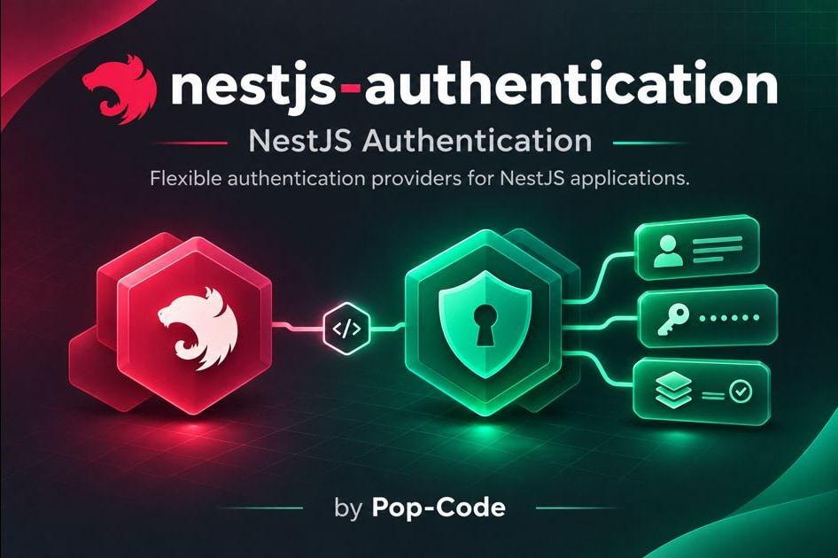

# nestjs-authentication



[](https://github.com/Pop-Code/nestjs-authentication/actions/workflows/test.yml)
[][npm]
[](https://codecov.io/gh/Pop-Code/nestjs-authentication)

Authentication for [NestJS](https://nestjs.com) with several user sources and every transport. Any [passport](https://www.passportjs.org) strategy works too, but passport is optional.

- One guard, global with `@Auth()` / `@Public()` or per route, that tries one or more strategies in order, optionally from the session first
- Native `jwt` (jsonwebtoken), `emailpassword` and `session` strategies, your own (`AuthStrategy`), and the passport ecosystem through an adapter
- Scopes: `@RequireScopes()` from the token claims or your roles, and the list of the scopes of the application
- Auth providers per **namespace**: users, admins, api clients... each loaded from its own source
- Login sessions (express-session, @fastify/session, @fastify/secure-session), with the user stored as a small payload and loaded back on each request
- Every transport: http (express, fastify), GraphQL (queries, mutations, subscriptions), websockets (socket.io, ws), microservices
- `@CurrentUser()`, `@CurrentAuth()`, and the user of the current request in any service (`AuthContextService`)
- Password hashing with scrypt (built in), migration of legacy hashes on login, or your own encryptor (bcrypt, argon2...)

## Requirements

| nestjs-authentication | NestJS | passport                 | Node.js  |
| --------------------- | ------ | ------------------------ | -------- |
| 0.5.x                 | 12     | optional (0.6, 0.7)      | >= 22.12 |
| 0.4.x                 | 8      | 0.5 + @nestjs/passport 8 | >= 14    |

## Install

```bash
npm install nestjs-authentication
# for login sessions: express-session (express), or @fastify/session / @fastify/secure-session (fastify)
npm install express-session
# optional, to use passport strategies (OAuth providers, SAML, LDAP...)
npm install passport
```

## Quick start

```ts
// app.module.ts
@Module({
    imports: [
        AuthModule.forRoot({
            encryptor: new ScryptEncryptor(),
            jwt: { secretOrKey: process.env.JWT_SECRET, algorithms: ['HS256'] },
            // the options of @Auth(): a valid token, or 401
            defaults: { strategies: { jwt: {} }, required: true, exceptionFactory: unauthorized() }
        }),
        // your users keep their shape: say how to find and read them
        AuthModule.registerAuthProviders(
            [
                {
                    provide: 'USERS_AUTH_PROVIDER',
                    inject: [ENCRYPTOR, UsersService],
                    useFactory: (encryptor: IEncryptor, users: UsersService) =>
                        new EmailPasswordAuthProvider<User>({
                            encryptor,
                            findById: (id) => users.findById(id),
                            findByEmail: (email) => users.findByEmail(email),
                            getId: (user) => user.id,
                            getPasswordHash: (user) => user.passwordHash
                        })
                }
            ],
            [UsersModule]
        )
    ],
    controllers: [AuthController]
})
export class AppModule {}

// auth.controller.ts
@Controller('auth')
export class AuthController {
    constructor(private readonly jwt: JwtStrategy<User>) {}

    // email + password in the body
    @Post('login')
    @Auth({ strategies: { emailpassword: {} } })
    login(@CurrentUser() user: User) {
        return { token: this.jwt.signUser(user, { expiresIn: '1h', scope: ['orders:read'] }) };
    }

    // a valid token with the scope
    @Get('orders')
    @Auth()
    @RequireScopes('orders:read')
    orders(@CurrentUser() user: User) {}
}
```

The same decorators protect GraphQL resolvers, websocket gateways and microservices. The [Getting started](https://github.com/Pop-Code/nestjs-authentication/wiki/Getting-Started) tutorial builds this app step by step.

## Documentation

- [Wiki](https://github.com/Pop-Code/nestjs-authentication/wiki)
- [API](https://pop-code.github.io/nestjs-authentication)
- [Changelog](https://github.com/Pop-Code/nestjs-authentication/blob/master/CHANGELOG.md)

## Development

```bash
yarn install
yarn lint && yarn build && yarn test
yarn doc # regenerate the API reference in ./docs
```

The tests need Node.js >= 24.9 (Jest loads the ESM-only NestJS 12 packages).
See [RELEASING.md](./RELEASING.md) to publish a version.

[npm]: https://www.npmjs.com/package/nestjs-authentication
